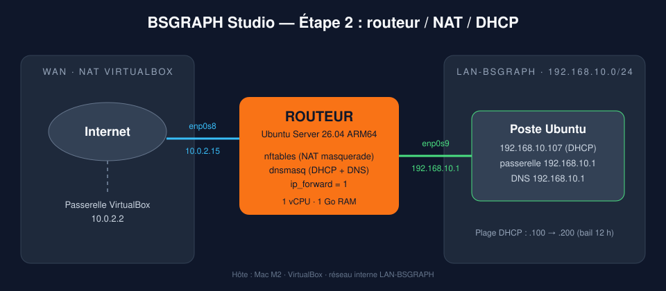
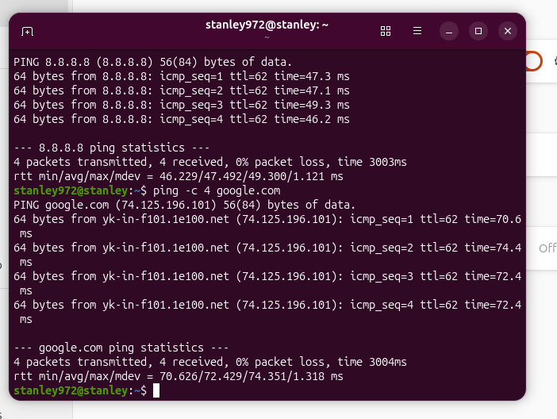
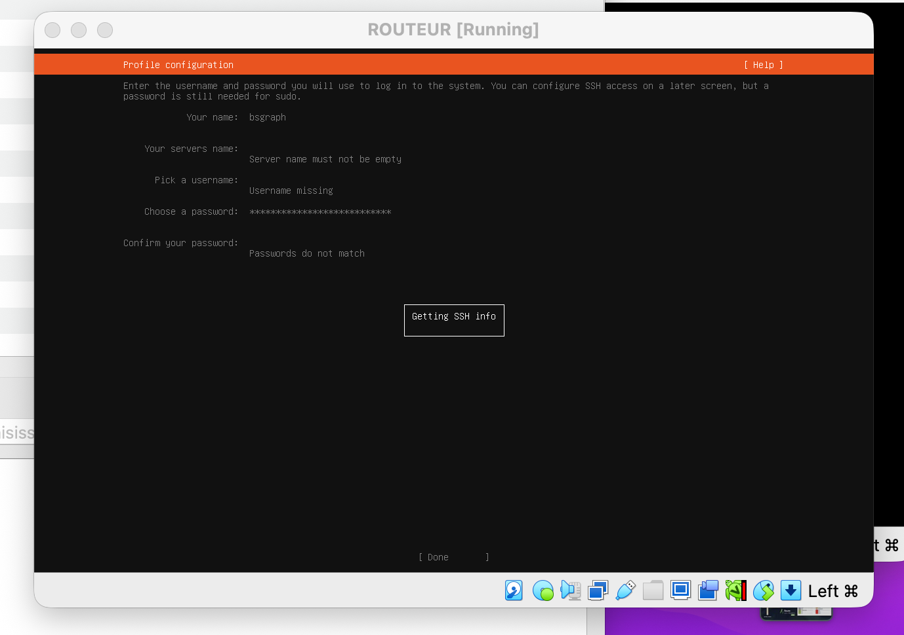
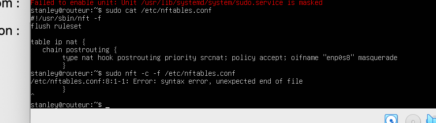
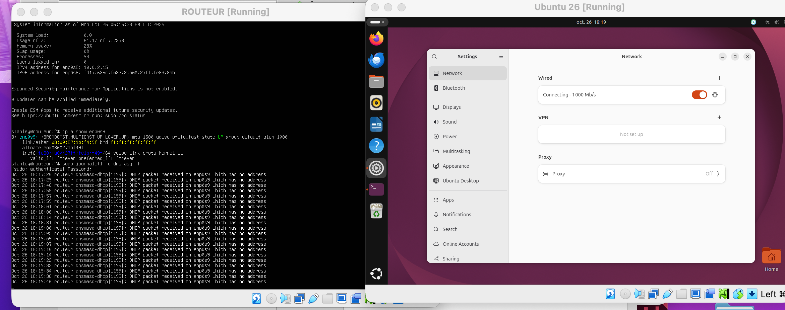
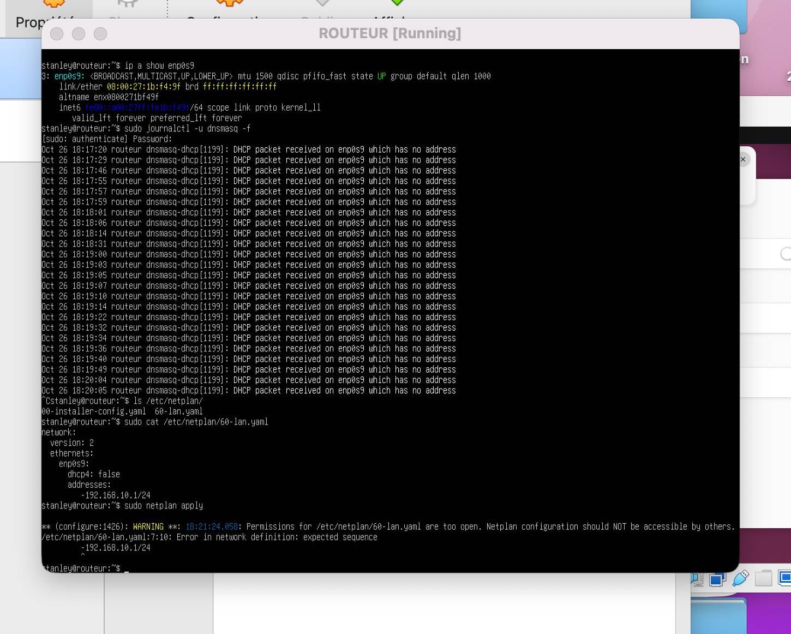
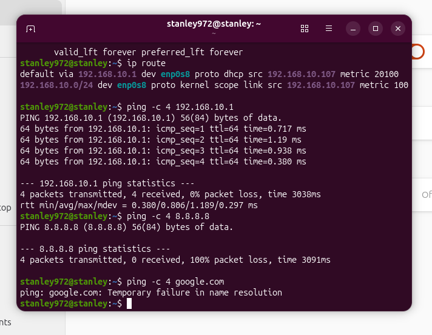

# Étape 2 — Routeur Linux : routage, NAT et DHCP



## Objectif

Donner à l'agence fictive **BSGRAPH Studio** un réseau interne isolé (`192.168.10.0/24`) dont tous les postes sortent sur Internet **uniquement à travers un routeur Linux** que j'administre, comme le ferait une box ou un pare-feu en entreprise.

Le Mac M2 étant en architecture **ARM64**, pfSense/OPNsense ne sont pas disponibles : le routeur est donc construit « à la main » sur un Ubuntu Server, ce qui oblige à comprendre chaque brique.

## Infrastructure

| Machine | Rôle | Carte | Réseau VirtualBox | Adresse |
|---|---|---|---|---|
| ROUTEUR | Routeur / NAT / DHCP / DNS | `enp0s8` | NAT (WAN) | 10.0.2.15 (DHCP VirtualBox) |
| | | `enp0s9` | Réseau interne `LAN-BSGRAPH` | **192.168.10.1** (fixe) |
| Poste Ubuntu | Client de l'agence | `enp0s8` | Réseau interne `LAN-BSGRAPH` | 192.168.10.107 (reçue du DHCP) |

ROUTEUR : Ubuntu Server 26.04.1 ARM64, 1 vCPU, 1 Go de RAM, 10 Go de disque.

## Mise en œuvre

### 1. Adresse fixe côté LAN — Netplan
Fichier : [`configs/60-lan.yaml`](configs/60-lan.yaml) → `/etc/netplan/60-lan.yaml`

```bash
sudo chmod 600 /etc/netplan/60-lan.yaml   # Netplan exige un fichier non lisible par les autres
sudo netplan apply
ip a show enp0s9                          # vérification : inet 192.168.10.1/24
```

### 2. Activation du routage IPv4
Fichier : [`configs/99-routeur.conf`](configs/99-routeur.conf) → `/etc/sysctl.d/99-routeur.conf`

```bash
sudo sysctl --system
sysctl net.ipv4.ip_forward                # vérification : = 1
```

### 3. NAT avec nftables
Fichier : [`configs/nftables.conf`](configs/nftables.conf) → `/etc/nftables.conf`

Tout ce qui sort par la carte WAN est masqué derrière l'adresse du routeur (`masquerade`).

```bash
sudo nft -c -f /etc/nftables.conf         # vérifie la syntaxe sans appliquer
sudo systemctl enable --now nftables
sudo nft list ruleset
```

### 4. DHCP + DNS avec dnsmasq
Fichier : [`configs/bsgraph.conf`](configs/bsgraph.conf) → `/etc/dnsmasq.d/bsgraph.conf`

- écoute **uniquement** sur le LAN (`interface=enp0s9`, `bind-dynamic`)
- distribue les adresses `.100` à `.200`, bail de 12 h
- annonce le routeur comme passerelle et DNS
- relaie les requêtes DNS vers 1.1.1.1 et 8.8.8.8 (`no-resolv`)

```bash
sudo dnsmasq --test
sudo systemctl restart dnsmasq
sudo systemctl status dnsmasq
```

## Validation

Tests réalisés depuis le poste client, couche par couche :

| Test | Commande | Ce qu'il prouve | Résultat |
|---|---|---|---|
| 1 | `ip a` | le DHCP a attribué une adresse | ✅ 192.168.10.107 |
| 2 | `ip route` | la passerelle est connue | ✅ `default via 192.168.10.1` |
| 3 | `ping -c 4 192.168.10.1` | le client joint le routeur | ✅ 0 % de perte |
| 4 | `ping -c 4 8.8.8.8` | routage + NAT fonctionnent | ✅ 0 % de perte |
| 5 | `ping -c 4 google.com` | la résolution DNS fonctionne | ✅ 0 % de perte |

Le **TTL de 62** reçu par le client (contre 64 sur le routeur) confirme que les paquets traversent bien le routeur.



## Problèmes rencontrés et résolution

### Installateur figé sur « Getting SSH info »
- **Symptôme :** l'écran de création du compte ne répondait plus.
- **Cause :** 1 Go de RAM est insuffisant pour l'*installateur* d'Ubuntu Server.
- **Solution :** passage temporaire à 2 Go pendant l'installation, puis retour à 1 Go (suffisant en fonctionnement).



### nftables refuse de démarrer — `unexpected end of file`
- **Diagnostic :** `sudo nft -c -f /etc/nftables.conf` pointe la ligne fautive.
- **Cause :** une accolade fermante `}` manquante.
- **Solution :** ajout de l'accolade, revalidation avec `-c` avant de relancer le service.



### Le client reste sur « Connecting » — `DHCP packet received on enp0s9 which has no address`
- **Diagnostic :** suivi des logs en direct avec `sudo journalctl -u dnsmasq -f`. Les requêtes du client arrivaient bien (câblage virtuel OK), mais la carte LAN du routeur n'avait pas d'adresse.



- **Cause :** erreur de syntaxe YAML, `netplan apply` → `expected sequence` : il manquait l'espace après le tiret (`-192.168.10.1/24` au lieu de `- 192.168.10.1/24`).
- **Solution :** correction de l'indentation, `chmod 600`, réapplication.



### Le client joint le routeur mais pas Internet
- **Diagnostic :** test 3 OK, tests 4 et 5 KO → le blocage se situe dans le routeur, entre ses deux cartes.
- **Cause :** routage IPv4 non activé.
- **Solution :** `net.ipv4.ip_forward=1` + ajout de serveurs DNS explicites dans dnsmasq.



## Ce que j'en retiens

- Toujours **valider une configuration avant de l'appliquer** (`nft -c`, `dnsmasq --test`, `netplan apply` qui signale les erreurs).
- Diagnostiquer **couche par couche** : adresse → passerelle → routeur → Internet → DNS. Le premier test qui échoue indique où chercher.
- Les **logs en direct** (`journalctl -f`) donnent souvent la réponse exacte.
- En YAML, l'indentation et les espaces font partie de la syntaxe.

## Compétences mobilisées

`Linux` · `Ubuntu Server` · `Netplan` · `routage IPv4` · `NAT` · `nftables` · `DHCP` · `DNS` · `dnsmasq` · `systemd` · `VirtualBox` · `diagnostic réseau`
