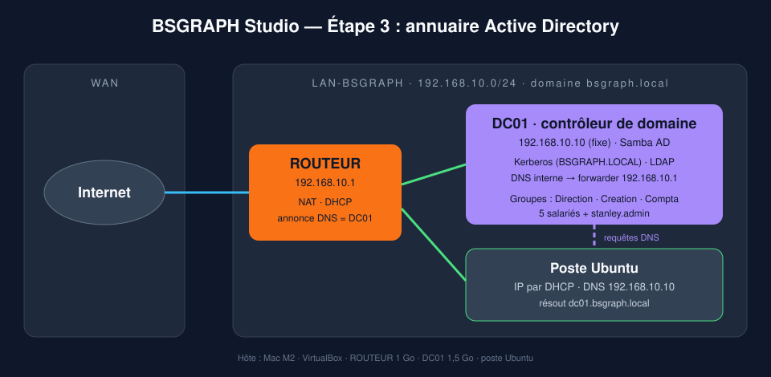
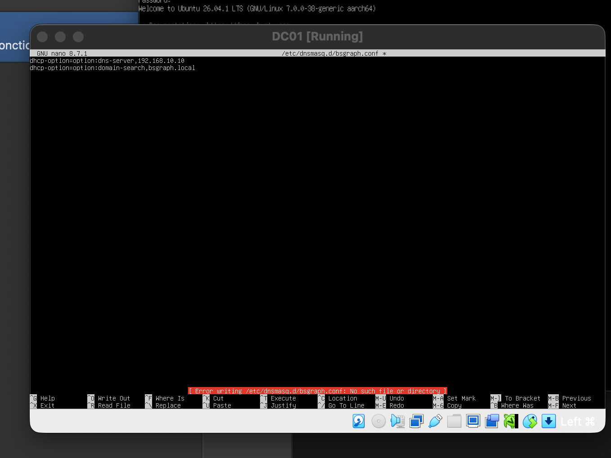
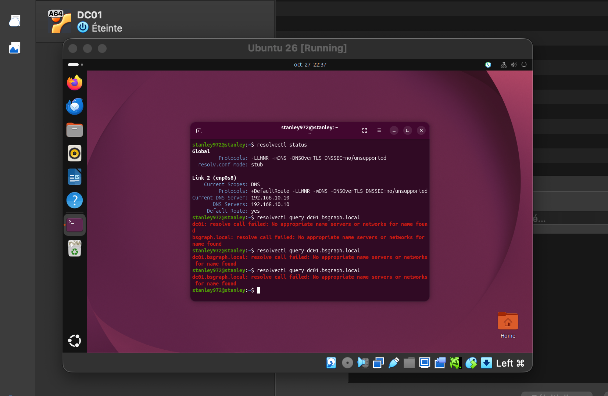
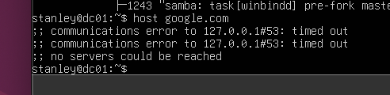
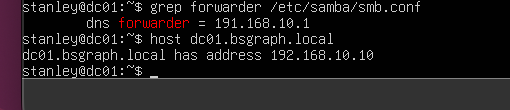

# Étape 3 — Annuaire Active Directory avec Samba



## Objectif

Doter l'agence **BSGRAPH Studio** d'un **annuaire centralisé** : un seul endroit qui gère les comptes des salariés, leurs mots de passe et leurs groupes. Chaque salarié dispose d'un identifiant unique pour se connecter à n'importe quel poste du domaine **`bsgraph.local`**.

Windows Server n'existant pas en version ARM64 installable sur le Mac M2, le contrôleur de domaine est monté avec **Samba AD**, compatible avec les postes et outils Windows (Kerberos, LDAP, DNS, GPO).

## Infrastructure

| Machine | Rôle | Adresse | Ressources |
|---|---|---|---|
| ROUTEUR | NAT, DHCP (annonce DC01 comme DNS) | 192.168.10.1 | 1 Go |
| **DC01** | Contrôleur de domaine Samba AD + DNS interne | **192.168.10.10** (fixe) | 1,5 Go (2 Go pendant l'installation), 15 Go |
| Poste Ubuntu | Client | DHCP (.100 à .200) | — |

DC01 : Ubuntu Server 26.04.1 ARM64, une seule carte sur le réseau interne : il sort sur Internet **via le routeur**, comme un vrai serveur d'entreprise.

## Mise en œuvre

### 1. Adresse fixe et nom complet
Un contrôleur de domaine doit avoir une adresse fixe, hors de la plage DHCP, et connaître son nom complet (FQDN).

- [`configs/60-lan.yaml`](configs/60-lan.yaml) → `/etc/netplan/60-lan.yaml` (adresse, passerelle, DNS)
- [`configs/hosts`](configs/hosts) → `/etc/hosts`

```bash
hostname -f        # dc01.bsgraph.local
```

### 2. Installation de Samba et Kerberos
```bash
sudo apt install -y samba-ad-dc krb5-user bind9-dnsutils smbclient
# Realm Kerberos : BSGRAPH.LOCAL · serveurs : dc01.bsgraph.local
sudo systemctl disable --now smbd nmbd winbind
sudo mv /etc/samba/smb.conf /etc/samba/smb.conf.orig
```

### 3. Création du domaine
```bash
sudo samba-tool domain provision --use-rfc2307 --interactive
```
| Paramètre | Valeur |
|---|---|
| Realm | `BSGRAPH.LOCAL` |
| Domaine NetBIOS | `BSGRAPH` |
| Rôle | `dc` |
| DNS | `SAMBA_INTERNAL` |
| DNS forwarder | `192.168.10.1` (le routeur) |

### 4. Kerberos et DNS
```bash
sudo cp /var/lib/samba/private/krb5.conf /etc/krb5.conf
sudo systemctl disable --now systemd-resolved   # libère le port 53 pour Samba
sudo unlink /etc/resolv.conf
```
[`configs/resolv.conf`](configs/resolv.conf) → `/etc/resolv.conf` : le serveur s'interroge lui-même.

```bash
sudo systemctl unmask samba-ad-dc
sudo systemctl enable --now samba-ad-dc
```

### 5. Comptes et groupes

| Service (groupe) | Salarié | Identifiant |
|---|---|---|
| Direction | Claire Martin | `cmartin` |
| Creation | Lucas Bernard | `lbernard` |
| Creation | Inès Moreau | `imoreau` |
| Creation | Hugo Petit | `hpetit` |
| Compta | Paul Durand | `pdurand` |
| Domain Admins | Stanley (admin nominatif) | `stanley.admin` |

```bash
sudo samba-tool group add Creation
sudo samba-tool user create lbernard --given-name=Lucas --surname=Bernard --must-change-at-next-login
sudo samba-tool group addmembers Creation lbernard,imoreau,hpetit
sudo samba-tool group addmembers "Domain Admins" stanley.admin
```

Bonnes pratiques appliquées :
- mot de passe provisoire **à changer à la première connexion**
- **compte admin nominatif** plutôt que le compte `Administrator`, pour la traçabilité

### 6. Annonce du DNS aux postes
Sur le routeur, dnsmasq distribue désormais DC01 comme serveur DNS et `bsgraph.local` comme domaine ([config mise à jour](../etape-02-routeur/configs/bsgraph.conf)).

Sur le poste Ubuntu : [`configs/resolved-bsgraph.conf`](configs/resolved-bsgraph.conf) → `/etc/systemd/resolved.conf.d/bsgraph.conf`

## Validation

| Test | Machine | Commande | Résultat attendu |
|---|---|---|---|
| Nom complet | DC01 | `hostname -f` | ✅ `dc01.bsgraph.local` |
| Enregistrements AD | DC01 | `host -t SRV _ldap._tcp.bsgraph.local` | ✅ SRV vers `dc01.bsgraph.local` |
| DNS interne | DC01 | `host dc01.bsgraph.local` | ✅ `192.168.10.10` |
| Transfert DNS | DC01 | `host google.com` | ✅ adresse IP |
| Kerberos | DC01 | `kinit administrator` puis `klist` | ✅ ticket `krbtgt/BSGRAPH.LOCAL` |
| Partages AD | DC01 | `smbclient -L localhost -N` | ✅ `netlogon`, `sysvol` |
| Résolution depuis un poste | Client | `resolvectl query dc01.bsgraph.local` | ✅ `192.168.10.10`, même après redémarrage |
| Internet depuis un poste | Client | `ping -c 4 google.com` | ✅ 0 % de perte |

## Problèmes rencontrés et résolution

### Commande lancée sur la mauvaise machine
- **Symptôme :** `Error writing /etc/dnsmasq.d/bsgraph.conf: No such file or directory`.
- **Cause :** fichier du routeur édité dans la console de DC01.
- **Leçon :** toujours lire le prompt (`stanley@routeur` / `stanley@dc01`) avant de taper.



### Le poste ne résout pas `dc01.bsgraph.local` : le piège du `.local`
- **Symptôme :** `resolve call failed: No appropriate name servers or networks for name found`, alors que le poste a bien reçu `DNS Servers: 192.168.10.10`.
- **Causes :**
  1. DC01 était éteint (oublié après la baisse de sa mémoire).
  2. Sous Linux, `systemd-resolved` réserve les noms en `.local` à **mDNS** (RFC 6762) et n'interroge pas le DNS classique, sauf si le domaine est déclaré explicitement.
- **Tentatives :** annonce du domaine par DHCP (`domain-search`, `domain=`) puis via `nmcli` : non prises en compte par le poste.
- **Solution :** déclaration du domaine dans `systemd-resolved` (`Domains=bsgraph.local`), validée d'abord à chaud avec `resolvectl domain`, puis rendue permanente et testée après redémarrage.
- **Leçon :** en production, on évite `.local` et on utilise un sous-domaine du domaine public (ex. `ad.bsgraph.fr`).



### DC01 ne résout plus les noms Internet : faute de frappe dans le forwarder
- **Diagnostic, couche par couche :** `host dc01.bsgraph.local` OK (DNS interne fonctionnel) mais `host google.com` → `timed out`. Le problème se situe donc dans le **transfert** vers l'extérieur.



- **Cause :** `dns forwarder = 191.168.10.1` au lieu de `192.168.10.1` dans `/etc/samba/smb.conf`.
- **Solution :** correction de l'adresse, redémarrage de `samba-ad-dc`.
- **Leçon :** une adresse IP mal saisie ne provoque aucune erreur sur le moment ; elle casse le service plus loin. Relire les IP chiffre par chiffre.



## Ce que j'en retiens

- Le **DNS est le pilier de l'Active Directory** : sans lui, les postes ne trouvent pas le contrôleur de domaine.
- Isoler la panne en séparant **DNS interne** et **transfert vers l'extérieur**.
- Tester un correctif **à chaud** avant de le rendre permanent, puis valider **après redémarrage**.
- Un seul DNS = point de défaillance unique : en entreprise, on déploie **deux contrôleurs de domaine**.

## Compétences mobilisées

`Active Directory` · `Samba AD` · `Kerberos` · `DNS` · `LDAP` · `gestion des comptes et groupes` · `systemd-resolved` · `Netplan` · `dnsmasq` · `diagnostic DNS`
